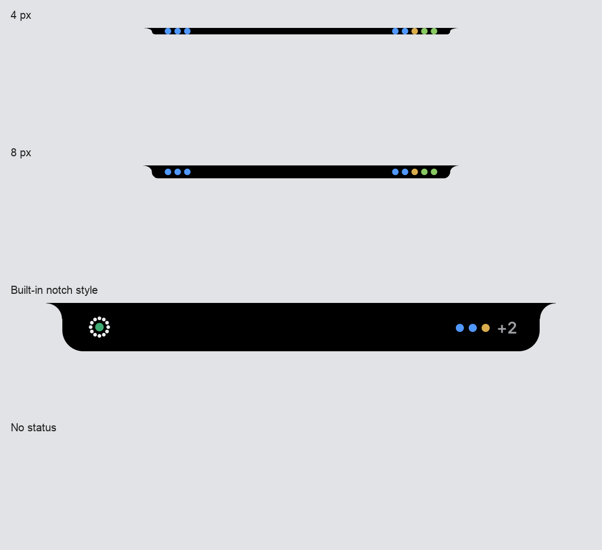

# Notch display modes — live QA

Verified on macOS on 2026-10-16 with a built-in display containing a physical
notch and an external primary display. The isolated development profile used
frontend port `1424`, service port `5103`, and Electron debugging port `9231`.

The screenshots use a fixture snapshot containing two running sessions, one
session awaiting permission, and two completed sessions with unread output.
No agent turn was started for these visual checks.

## Primary display styles

The comparison combines actual Electron renderer captures at the same scale.

| Setting | Observed compact status |
| --- | --- |
| `4 px` | A 4 px band with three activity points and five session points |
| `8 px` | An 8 px band with the same activity and session points |
| `Built-in notch style` | The full notch layout, including the existing overflow count |
| `No status` | No compact status or hover target; notification previews remain available |

## Verified behavior

- [x] All four choices save through the settings UI and update the live notch.
- [x] `Built-in always` disables `Primary display status`; selecting `Both`
      enables it again without losing the saved style.
- [x] `Both` creates one island on the built-in display and another on the
      external primary display, with separate geometry.
- [x] Opening the panel by hovering and choosing the 30-minute snooze action
      applies the same snooze deadline to both islands.
- [x] Resuming notifications clears snooze on both islands.
- [x] An empty ambient snapshot hides the virtual notch; new activity shows it.
- [x] The built-in notch contracts into the physical cutout while idle.
- [x] A notification preview remains visible with `No status`, and its close
      action returns to the hidden compact state.
- [x] With animation enabled, running session points animate while waiting and
      completed session points remain steady.
- [x] Reduced-motion emulation stops looping activity animations.
- [x] No renderer console errors occurred during these flows.

## Automated coverage

Focused tests cover display geometry, distinct-display selection, shared
snapshot and snooze delivery, notification queues, preference parsing, and
compact rendering. Existing snooze, panel, and overflow behavior is retained.

## Thin-strip overflow regression

Verified in the same isolated Electron development profile after the Greptile
review. Snapshots were delivered through the real Electron IPC bridge. A
92 px strip was simulated by updating the renderer's geometry state to the
external-only fallback, without disconnecting the physical displays.

The first sessions were a permission request, a question, and an unread reply,
followed by running sessions.

| Strip height | Sessions | Visible dots | Overflow |
| --- | --- | --- | --- |
| 4 px | 9 | 9 | None |
| 4 px | 10 | 7 | `+3` |
| 4 px | 24 | 6 | `+18` |
| 8 px | 9 | 9 | None |
| 8 px | 10 | 7 | `+3` |
| 8 px | 24 | 6 | `+18` |

- [x] Permission, question, and unread-reply dots remain first and fully visible.
- [x] All dots and the full overflow count fit horizontally and vertically.
- [x] The accessibility label includes all sessions and the overflow count.
- [x] Restoring the actual 185 px geometry shows all 24 dots and removes the count.
- [x] No renderer console errors occurred.

The six narrow-strip cases are also covered by renderer regression tests.
